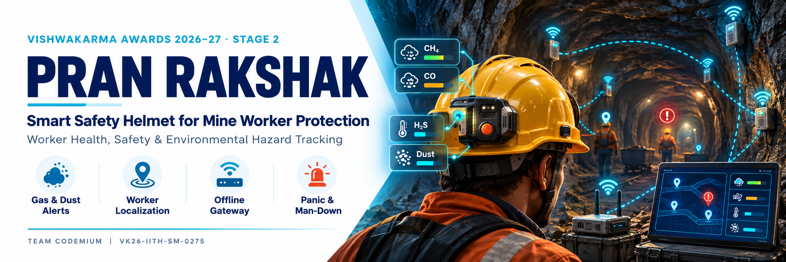
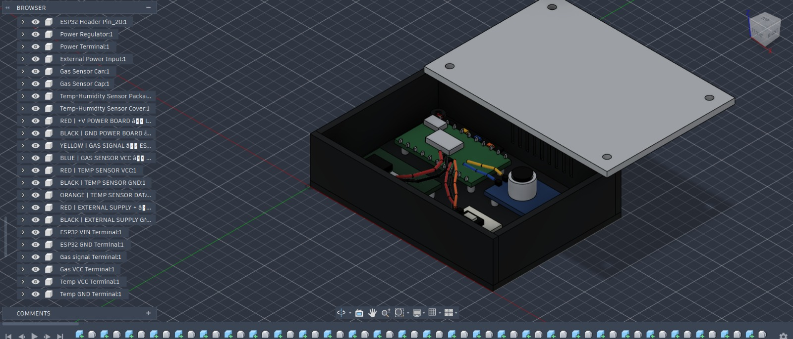
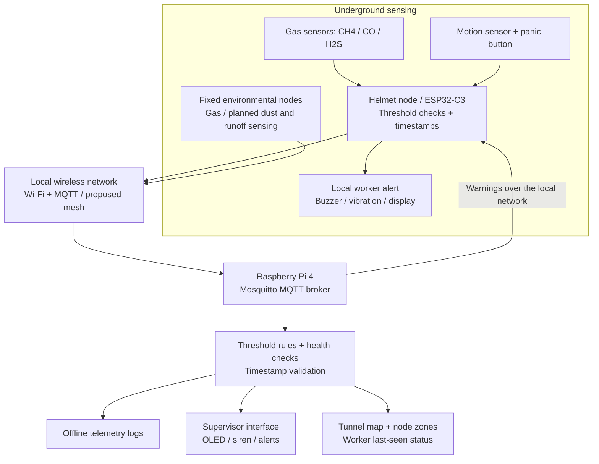
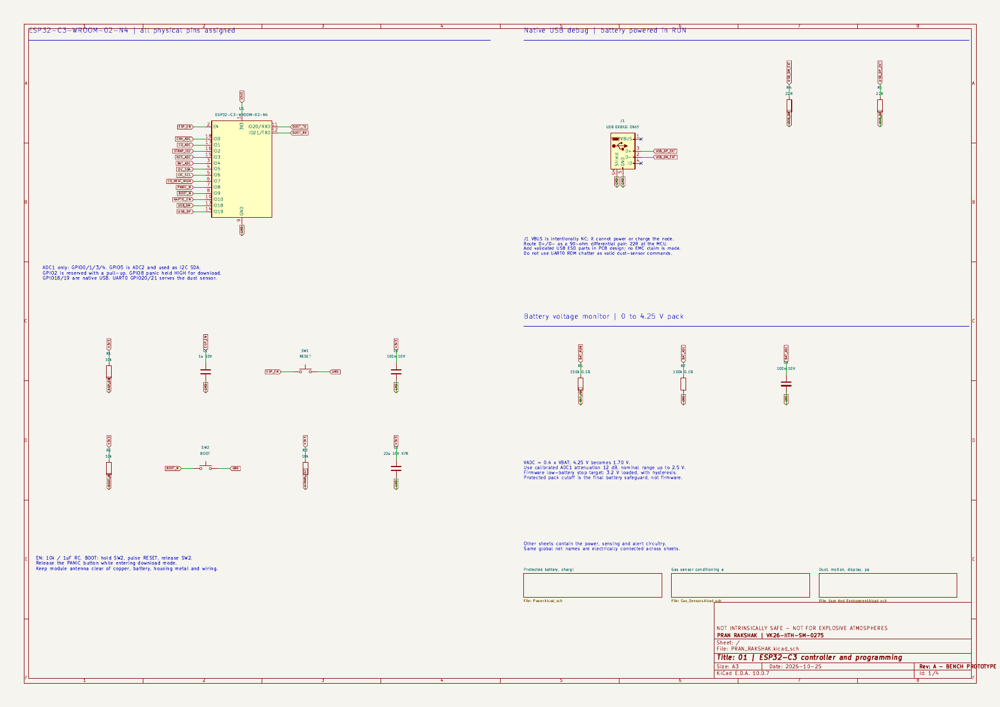
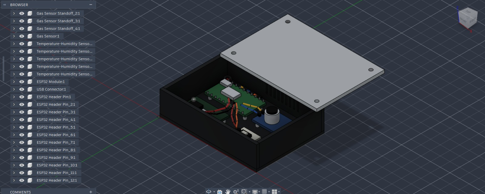
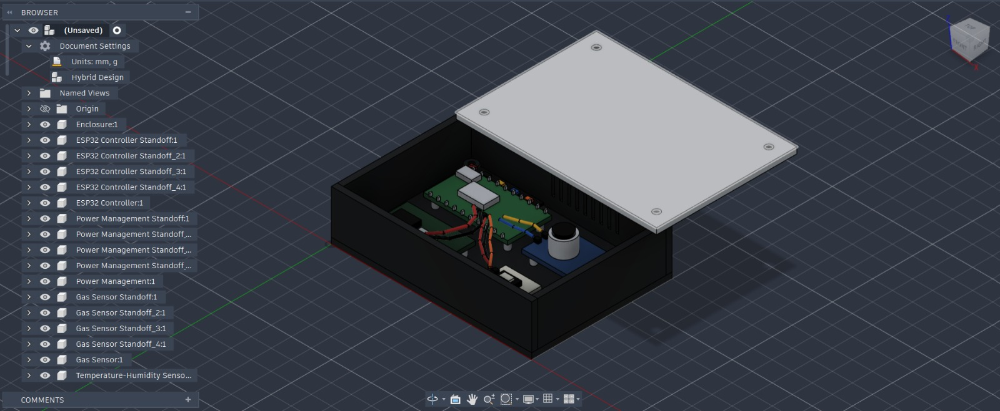

<p align="center">
  
  <br><sub>Concept illustration based on the Stage 2 submission.</sub>
</p>

<p align="center">
  <strong>Worker health, safety, and environmental hazard tracking.</strong><br>
  Vishwakarma Awards 2026–27 · Stage 2 · Team Codemium
</p>

<p align="center">
  <a href="#the-problem">The problem</a> ·
  <a href="#system-architecture">Architecture</a> ·
  <a href="#kicad-schematic">KiCad schematic</a> ·
  <a href="#cad-and-design-evidence">CAD gallery</a> ·
  <a href="cad/VKA2026.step">STEP model</a> ·
  <a href="docs/stage-2-submission.pdf">Stage 2 submission</a> ·
  <a href="#roadmap">Roadmap</a>
</p>

## PRAN RAKSHAK

PRAN RAKSHAK is a mine safety project designed to detect underground hazards, warn workers locally, and help rescue teams identify a worker's last-known zone. The proposed system combines helmet-mounted sensing, fixed monitoring nodes, and a Raspberry Pi gateway that can operate without a continuous internet connection.

Its scope covers methane, carbon monoxide, and hydrogen sulfide monitoring, with dust exposure and mine-runoff quality monitoring included in the wider environmental design. A panic button and motion-based man-down detection support worker distress alerts.

> **Current stage:** CAD and electrical schematic design, Revision A. The repository includes the STEP assembly, original CAD screenshots, an editable four-sheet KiCad project, BOM, schematic PDF, ERC report, and Stage 2 submission. Firmware, gateway software, calibration records, and field-test results remain pending. Performance figures below are design targets, with current schematic limitations stated separately.

<p align="center">
  
  <br><sub>Sensor-node assembly: enclosure, electronics, wiring, and removable lid shown in the CAD workspace.</sub>
</p>

## The problem

Underground miners can encounter toxic gases and respirable dust in areas with intermittent communication and limited visibility. Manual checks leave gaps between readings. If a worker becomes unresponsive, a team also needs to know where to search.

The Stage 2 submission identifies three connected monitoring gaps:

- Gas and dust exposure can build up between handheld inspections.
- Separate monitoring and communication systems delay distress alerts and worker location updates.
- Mine runoff may reach surrounding waterways before manual water-quality checks identify contamination.

PRAN RAKSHAK is intended for miners, ventilation officers, environmental monitoring teams, and rescue squads working across tunnels and nearby catchment areas.

## The proposed solution

Helmet-mounted nodes monitor conditions close to each worker. Fixed nodes extend environmental coverage through the mine. Both feed a local gateway for logging and supervision, while node-level threshold checks support alarms during a gateway connection loss.

| Capability | Proposed behavior |
| --- | --- |
| Hazard monitoring | Sample CH4, CO, and H2S; extend sensing to dust and runoff quality as those subsystems are defined. |
| Worker warnings | Trigger local buzzer/vibration alerts and display warnings when configured thresholds are crossed. |
| Emergency signaling | Send a manual panic event or an automatic man-down event after sustained inactivity. |
| Underground localization | Associate workers with nearby node zones on a mapped tunnel layout; retain last-seen information. |
| Offline supervision | Run the MQTT broker, rules, monitoring interface, and logs on an on-site Raspberry Pi. |
| Fault visibility | Flag missing nodes, stale packets, sensor faults, and low-power conditions. |

The submission also proposes airflow-aware leak-source estimation and early anomaly detection. These require ventilation measurements, calibration data, and validation beyond the current CAD model.

## System architecture

The diagram summarizes the proposed data flow in the submission. It does not represent software already included in this repository.



1. A node captures sensor readings and attaches a timestamp and node identity.
2. The controller checks local alarm conditions and sends telemetry over the local network.
3. The gateway validates incoming data, applies rules, and records readings offline.
4. Supervisors receive hazard and node-health information; worker positions are associated with mapped zones.

Wi-Fi/MQTT is the baseline communication design. Multi-hop routing, Kinetic Mesh, and alternative radio fallbacks appear in the submission as proposed extensions; their implementation and underground coverage remain to be demonstrated.

## Hardware and software design

| Subsystem | Requirement and current design |
| --- | --- |
| Node controller | ESP32-C3 for sensor acquisition and wireless telemetry; Revision A uses ESP32-C3-WROOM-02-N4 with boot/reset, native USB, and battery ADC circuitry. |
| Methane sensing | MQ-4 sensor, subject to calibration and heater-power validation. |
| Carbon monoxide sensing | MQ-7 requirement; Revision A proposes MQ-7B with heater-rail selection and ADC conditioning. Its heating cycle limits fresh measurement timing. |
| Hydrogen sulfide sensing | Electrochemical H2S requirement; Revision A provides an interface for a conditioned module. The exact cell/module and analog front end remain unresolved. |
| Temperature/humidity | A sensor is represented in the supplied CAD assembly; compensation is discussed in the risk-mitigation plan. |
| Motion and panic input | Revision A proposes LIS3DH motion sensing and a manual panic input. Man-down firmware and trials remain pending. |
| Dust and runoff sensing | Revision A proposes an SPS30 dust interface. Runoff sensing remains outside the node schematic; final measurement methods require validation. |
| Node power | Revision A includes a protected battery-pack interface, TP4056 charger, charge/run separation, 5 V boost, and regulated rails. Power and charging behavior require bench validation. |
| Local gateway | Raspberry Pi 4 Model B, 4 GB RAM, with Mosquitto MQTT and local processing. |
| Storage and outputs | Proposed 64 GB microSD logging, 1.3-inch OLED, and an 85 dB siren/alarm output. |
| Mechanical design | Enclosure, lid, mounting standoffs, board placement, and wiring represented in the STEP assembly. |

The STEP model is a mechanical presentation of one sensor pod. Its generic component geometry does not establish exact electronic part numbers or demonstrate the complete helmet, gateway, or multi-node installation.

## KiCad schematic

The [Revision A KiCad package](hardware/README.md) contains a four-sheet, editable ESP32-C3 node design. It includes project-local symbols, a reference-level BOM, the exported netlist, and electrical verification records. Proposed parts and unresolved interfaces are identified in its [design notes](hardware/kicad/Design_Notes.md).

[](hardware/kicad/Schematic_Review.pdf)

*Main controller sheet. Open the [four-page schematic PDF](hardware/kicad/Schematic_Review.pdf) for readable details and the power, gas-sensor, and user/environment sheets.*

| Sheet | Contents |
| --- | --- |
| [PRAN_RAKSHAK.kicad_sch](hardware/kicad/PRAN_RAKSHAK.kicad_sch) | ESP32-C3 controller, boot/reset, native USB, battery monitoring, and child-sheet hierarchy. |
| [Power.kicad_sch](hardware/kicad/Power.kicad_sch) | Protected pack interface, TP4056 charging, charge/run switch, boost converter, and regulators. |
| [Gas_Sensors.kicad_sch](hardware/kicad/Gas_Sensors.kicad_sch) | MQ-4/MQ-7B signal conditioning, heater selection, and conditioned H2S module interface. |
| [User_And_Environment.kicad_sch](hardware/kicad/User_And_Environment.kicad_sch) | Proposed SPS30 dust interface, LIS3DH accelerometer, OLED, panic input, and vibration-motor driver. |

Download the [complete KiCad ZIP](hardware/PRAN_RAKSHAK_KiCad.zip), or use the cloned repository. In KiCad 10, open [`hardware/kicad/PRAN_RAKSHAK.kicad_pro`](hardware/kicad/PRAN_RAKSHAK.kicad_pro), then open the schematic. Keep all four sheets, `PRAN.kicad_sym`, and `sym-lib-table` together.

| Design evidence | Result or file |
| --- | --- |
| Native KiCad ERC | **0 electrical errors, 68 footprint-review warnings, no exclusions or ignored checks**, reproduced with KiCad 10.0.7 after importing the package into this repository. |
| Remaining warnings | Unassigned footprints; footprint selection and PCB layout are still required. This is not a warning-free ERC result. |
| Verification record | [Original ERC JSON](hardware/kicad/ERC_Report.json) and [verification notes](hardware/kicad/Verification.md), which record 125 connection/structure checks. |
| Bill of materials | [Full BOM](hardware/kicad/BOM.csv) and [short BOM with proposed selections](hardware/kicad/Short_BOM.md); prices have not been quoted. |

Revision A is a bench schematic. Its design calculations estimate approximately **2.4–3.1 hours** of runtime under the stated load assumptions, below the eight-hour target. The proposed MQ-7B's **150-second heater cycle** also prevents a guaranteed fresh CO measurement within ten seconds across all phases. The H2S cell/AFE remains an open design item. See the [electrical design notes](hardware/kicad/Design_Notes.md) before building; no PCB layout or certified mining hardware is included.

## Engineering targets

These targets come from the project specification on page 7 of the [Stage 2 submission](docs/stage-2-submission.pdf). They have not been verified by measurements in this repository. The KiCad design notes identify current runtime and CO-sensor timing conflicts with these targets.

| Parameter | Design target |
| --- | --- |
| Gas sampling | 1 Hz for CH4, CO, and H2S |
| End-to-end gas alert | Less than 10 seconds between threshold crossing and helmet warning |
| Battery endurance | 8 hours on a 3.7 V, 2500 mAh LiPo |
| Average node power | Approximately 1 W, with sensor-heater duty cycling proposed |
| Wearable pod envelope | Approximately 52 × 88 × 28 mm and 120 g; a target, not a measured property of the supplied STEP file |
| Ingress protection | IP67 target; no ingress-test evidence supplied |
| Offline logging | At least 7 days at the local gateway |
| Missing-node detection | Flag a node within 30 seconds of lost contact |
| Man-down detection | Trigger after 30 seconds without motion |
| Worker localization | Nearest-node zone on a mapped tunnel network |

## CAD and design evidence

The three supplied screenshots retain the CAD application's component browser and workspace. They show the enclosure arrangement and assembly structure at the time of capture.

| Assembly overview | Enclosure and component tree |
| --- | --- |
| [](assets/cad/assembly-overview.jpeg) | [](assets/cad/enclosure-components.jpeg) |
| Board placement, gas-sensor module, internal wiring, and exploded lid. | Enclosure and mounting components visible alongside the assembly. |

The full-width image near the top shows the wiring in greater detail. Open any screenshot to inspect it at its original resolution.

### Download and inspect the model

- [Download VKA2026.step](https://github.com/SrivarsanK/PranRakshak/raw/refs/heads/main/cad/VKA2026.step)
- [Browse the model in this repository](cad/VKA2026.step)
- [Read the CAD component guide and provenance notes](cad/README.md)

Clone the repository to keep the model and its documentation together:

```bash
git clone https://github.com/SrivarsanK/PranRakshak.git
cd PranRakshak
```

Import `cad/VKA2026.step` into a STEP-compatible CAD application such as Fusion, FreeCAD, or SolidWorks. Units are millimetres. With the lid in its exploded position, inspect the enclosure, component placement, standoffs, and wiring.

The supplied file is a STEP assembly exchange model. The originating application's editable sketches and parametric feature history are separate deliverables and are not included here.

## Safety and reliability plan

The submission describes the following protections for implementation and testing:

| Failure condition | Planned response |
| --- | --- |
| Sensor drift, failure, or a stuck reading | Calibration checks, plausibility checks, and an explicit sensor-fault alert. |
| Node loses its gateway connection | Continue local threshold alarms; retry communication and flag the missing node at the gateway. |
| Stale or clock-skewed telemetry | Timestamp packets and reject stale data before localization; the FMEA proposes a 10-second cutoff. |
| Low battery or brownout | Monitor supply state, issue a low-power warning, and test watchdog/reset behavior. |
| Gateway failure | Preserve node-level alarms and identify loss of central monitoring. |
| Ventilation changes or poor node placement | Update the tunnel map and airflow assumptions, then repeat localization tests. |

Intrinsic safety, flame protection, enclosure sealing, and impact resistance require further engineering and test evidence. No mining-equipment certification is claimed by the materials in this repository.

## Roadmap

The schedule below follows the submission's October 2026–January 2027 fabrication plan. The Revision A schematic, BOM, and ERC evidence are now published; footprint selection, procurement, and calibration remain open.

| Period | Planned work | Evidence to publish |
| --- | --- | --- |
| October 2026 | Review Revision A, resolve footprints and open interfaces, procure components, and bench-calibrate gas sensors. | KiCad project, BOM, and ERC report published; final component selection, quotes, and calibration records pending. |
| November 2026 | Assemble four sensor nodes and the helmet unit; bring up the Pi gateway, broker, display, and alarms. | Assembly photos, firmware, gateway configuration, and timestamped telemetry. |
| December 2026 | Test connectivity, node loss, man-down detection, watchdogs, brownouts, and corridor localization. | Integration logs and measured alert/localization behavior. |
| January 2027 | Run endurance and drift tests, tune the system, and prepare the Stage 3 demonstration. | Battery measurements, soak-test records, and demonstration evidence. |

## Repository contents

```text
PranRakshak/
├── README.md
├── assets/
│   ├── pran-rakshak-banner.png
│   ├── cad/
│   │   ├── assembly-wiring.jpeg
│   │   ├── assembly-overview.jpeg
│   │   └── enclosure-components.jpeg
│   └── schematic/
│       └── esp32-c3-overview.png
├── cad/
│   ├── README.md
│   └── VKA2026.step
├── hardware/
│   ├── README.md
│   ├── PRAN_RAKSHAK_KiCad.zip
│   └── kicad/                    # Native project, sheets, symbols, BOM, PDF, and reports
└── docs/
    ├── banner-design.md
    ├── design-notes.md
    └── stage-2-submission.pdf
```

For the evidence inventory, source-page mapping, and unresolved specification details, see [design notes](docs/design-notes.md).

## Team and submission

| Field | Details |
| --- | --- |
| Project | PRAN RAKSHAK |
| Team | Codemium |
| Team leader | Kaaviya Varshini V |
| Team ID | VK26-IITH-SM-0275 |
| Event | Vishwakarma Awards 2026–27, Stage 2 |
| Theme | Theme 5: Sustainable Mining — Worker Health, Safety & Environmental Hazard Tracking |

## Sources and acknowledgements

The team's [Stage 2 submission PDF](docs/stage-2-submission.pdf) supplies the project scope and specifications; the CAD screenshots and STEP model document the supplied design. Template examples are excluded as evidence of completed work.

The [Revision A electrical design notes](hardware/kicad/Design_Notes.md) document the KiCad schematic's engineering choices, calculations, and component datasheet references. These proposed choices are distinguished from the submission's requirements.

The banner is an AI-generated concept illustration derived from the PDF's mining-safety concept and architecture. Its [design notes and generation prompt](docs/banner-design.md) record the source pages.

The README's visual organization takes inspiration from [REACH by dmunish](https://github.com/dmunish/reach#readme).
