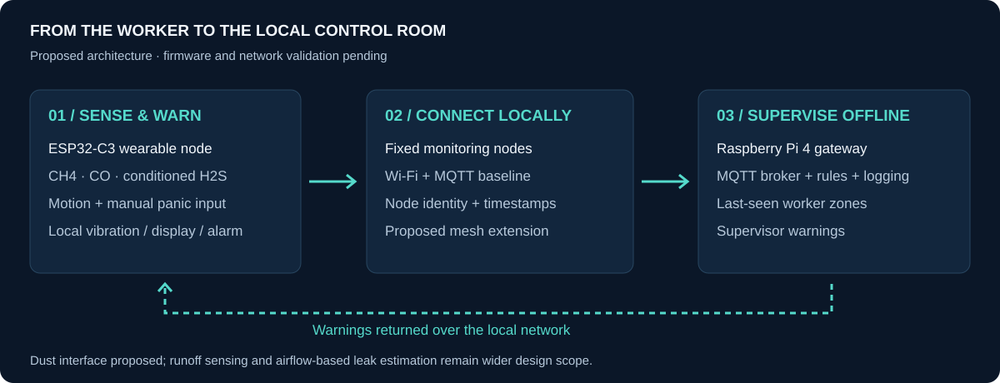
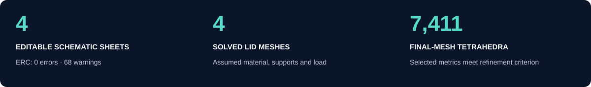

<p align="center"></p>

<h1 align="center">PRAN RAKSHAK</h1>
<p align="center"><strong>Worker health, safety & environmental hazard tracking.</strong><br>
An offline-capable mine-safety system bringing hazard warnings, worker zones, and distress alerts into one proposed workflow.</p>

<p align="center"></p>

<p align="center"><a href="#problem">Problem</a> · <a href="#solution">Solution</a> · <a href="#evidence">Stage 2 evidence</a> · <a href="#design">Hardware</a> · <a href="#fea">FEA</a> · <a href="#roadmap">Roadmap</a></p>
<p align="center"><a href="docs/stage-2-submission-updated.pdf"><strong>Read the submission ↗</strong></a> &nbsp; | &nbsp; <a href="cad/VKA2026.step"><strong>Open the STEP model ↗</strong></a> &nbsp; | &nbsp; <a href="hardware/README.md"><strong>Explore KiCad files ↗</strong></a></p>

> **Stage 2 status:** Mechanical CAD, an editable schematic, a separate PCB draft, and a preliminary lid FEA study are available. Firmware, calibrated hardware, and field trials remain pending. The schematic and PCB are different variants and must be reconciled before fabrication.

<a id="problem"></a>
##  The problem

Underground workers need warnings where hazards occur, even when internet access is unavailable. The submission identifies three gaps in manual, fragmented monitoring:

<table>
<tr>
<td width="33%" valign="top">
<h3 align="center"><br>Invisible exposure</h3>
<p align="center">Gas and respirable dust can build up between handheld inspections. Workers need local, timely warnings.</p>
</td>
<td width="33%" valign="top">
<h3 align="center"><br>Uncertain location</h3>
<p align="center">When a worker needs help, disconnected monitoring systems can leave rescue teams without a useful last-known zone.</p>
</td>
<td width="33%" valign="top">
<h3 align="center"><br>Environmental gaps</h3>
<p align="center">Periodic runoff checks can miss contamination between samples. Water-quality monitoring forms part of the wider proposal.</p>
</td>
</tr>
</table>

**Designed for:** underground mine workers, ventilation officers, rescue teams, and environmental monitoring teams. The intended benefit is earlier awareness and more useful rescue information; impact has not yet been measured in a mine.

<a id="solution"></a>
##  The solution

PRAN RAKSHAK proposes helmet-mounted sensor nodes, fixed environmental nodes, and an on-site Raspberry Pi gateway. Worker nodes check local thresholds and provide warnings; the gateway brings telemetry, distress events, and last-seen zones together without depending on continuous internet access.

<p align="center"></p>

1. **Sense:** acquire gas readings and motion/panic inputs with node identity and timestamps.
2. **Warn locally:** drive vibration, display, or alarm outputs from threshold checks, including during gateway connection loss.
3. **Coordinate:** send telemetry to a local gateway for rules, health checks, and offline records.
4. **Locate by zone:** associate workers with nearby mapped nodes and retain last-seen information for supervisors.

**The integration idea:** connect exposure monitoring, worker distress, and zone information in one local workflow. Dust sensing is proposed in the schematic; runoff sensing and airflow-aware leak estimation remain wider design work. Wi-Fi/MQTT is the baseline; mesh routing and underground coverage still need implementation and testing.

<a id="evidence"></a>
##  Stage 2 · evidence for review

<p align="center"></p>

Start with the submission, then inspect the native files and their check reports. Screenshots and previews are paired with editable sources wherever available.

| Review area | Open the evidence | What it establishes |
| :--- | :--- | :--- |
| **Project submission** | [Updated 29-page PDF](docs/stage-2-submission-updated.pdf) | Team concept, targets, BOM, maker journey, risks, and fabrication plan. |
| **Mechanical design** | [STEP assembly](cad/VKA2026.step) · [CAD guide](cad/README.md) | Enclosure, lid, standoffs, component placement, and wiring geometry. Original parametric sketch history is not included. |
| **Circuit design** | [Native KiCad project](hardware/kicad/PRAN_RAKSHAK.kicad_pro) · [Schematic PDF](hardware/kicad/Schematic_Review.pdf) · [ERC](hardware/kicad/ERC_Report.json) | Four editable sheets. Reproduced ERC: **0 electrical errors, 68 footprint warnings**, no excluded or ignored checks. |
| **PCB draft** | [Native board](hardware/pcb/PRAN_RAKSHAK_RevA.kicad_pcb) · [DRC review](hardware/pcb/review/README.md) | Partial routing. **5 errors, 56 warnings, and 33 unconnected items**; five default checks ignored, schematic parity unchecked. |
| **Mechanical analysis** | [FEA report](simulation/lid-pressure/README.md) · [PDF report](docs/preliminary-lid-fea.pdf) · [Mesh statistics](simulation/lid-pressure/results/mesh_statistics.csv) | Four actual solves, selected-metric convergence, numerical checks, and raw outputs under recorded assumptions. |
| **Reproducibility** | [Schematic ZIP](hardware/PRAN_RAKSHAK_KiCad.zip) · [PCB ZIP](hardware/PRAN_RAKSHAK_KiCad_RevA_Design_Package.zip) · [FEA ZIP](simulation/PranRakshak_Preliminary_Lid_FEA.zip) | Downloadable packages for inspection and rerunning the mechanical study. |

<a id="design"></a>
##  Hardware & engineering design

| Subsystem | Current design or proposal | Review focus |
| :--- | :--- | :--- |
| **Worker node** | ESP32-C3-WROOM-02-N4, boot/reset, native USB, battery monitoring | Firmware and bring-up pending. |
| **Gas sensing** | MQ-4, MQ-7B conditioning/heater control, conditioned H2S interface | Calibration, heater power, and final H2S module/AFE selection. |
| **Worker interaction** | LIS3DH, manual panic input, OLED, vibration driver | Man-down algorithm, thresholds, and false-alarm trials. |
| **Environmental scope** | Proposed SPS30 dust interface; temperature/humidity component in CAD | Sensor suitability and packaging; runoff subsystem still unspecified. |
| **Power** | Protected pack interface, TP4056 charging, charge/run switch, boost and regulated rails | Bench verification and endurance. |
| **Local gateway** | Raspberry Pi 4, Mosquitto MQTT, microSD logging, display/siren | Proposed software and gateway wiring require implementation. |
| **Enclosure** | STEP assembly with removable lid and mounting standoffs | Packaging, material choice, sensor access, sealing, and mounting. |

### Circuit and PCB views

| Four-sheet schematic · controller overview | Separate PCB carrier · draft |
| :---: | :---: |
| <a href="hardware/kicad/Schematic_Review.pdf"></a> | <a href="hardware/pcb/README.md"></a> |
| Native KiCad export; open the PDF for all four sheets. | Programmatic preview; open the native DRC report for findings. |

The schematic includes [controller](hardware/kicad/PRAN_RAKSHAK.kicad_sch), [power](hardware/kicad/Power.kicad_sch), [gas](hardware/kicad/Gas_Sensors.kicad_sch), and [user/environment](hardware/kicad/User_And_Environment.kicad_sch) sheets, with [BOM](hardware/kicad/BOM.csv) and [design notes](hardware/kicad/Design_Notes.md). Keep the local symbol library and all sheets together when opening the project in KiCad 10.

**Integration gap:** the 52 × 88 mm, two-layer PCB is a separate carrier with 49 footprints and 27 named nets. It uses an ADS1115, different GPIO/sensor interfaces, and externally regulated 3.3 V/5 V supplies. It has no onboard charger or protection and no matching supplied schematic. Complete routing, assign/verify footprints, reconcile the variants, and clear the checks before fabrication.

<a id="cad"></a>
##  CAD · inside the sensor pod

<p align="center"><a href="cad/VKA2026.step"></a><br><sub>Original CAD workspace capture. The exploded lid exposes the board placement and internal wiring.</sub></p>

| Assembly overview | Component structure |
| :---: | :---: |
| [](assets/cad/assembly-overview.jpeg) | [](assets/cad/enclosure-components.jpeg) |

Import [`cad/VKA2026.step`](cad/VKA2026.step) into a STEP-compatible CAD application; units are millimetres. Measured geometry is **100 × 70 × 25 mm for the enclosure** and **100 × 70 × 3 mm for the lid**, with four 3.5 mm lid holes. The geometry represents a sensor pod; full helmet integration and the smaller submission target remain to be resolved.

<a id="fea"></a>
##  FEA · mesh refinement with raw results

The supplied STEP lid was isolated and solved as a preliminary static, linear-elastic model. **Material remains undecided:** the study assumes an isotropic polymer with E = 2,000 MPa and ν = 0.35, a uniform 10 N downward force, and fully fixed screw-hole walls.

[](simulation/lid-pressure/README.md)

| Result under these assumptions | Value |
| :--- | :--- |
| Mesh sequence | 2,449 → 3,490 → 4,822 → 7,411 tetrahedra |
| Final displacement model | 14,188 quadratic nodes · 42,564 degrees of freedom |
| Centre deflection | **0.06623 mm** |
| Final refinement change | **0.319%** centre deflection · **0.096%** fixed central stress measure |
| Selected convergence criterion | Both measures changed by <2% for two successive refinements |
| Numerical verification | Analytical uniaxial-tension check passed; force balance and free-DOF residual checked |

**Scope of the result:** convergence applies to the selected measures, not an absolute error bound or converged maximum clamp stress. No material strength or safety factor is established. The model excludes base flexibility, bolts/contact, gasket, impact, fatigue, and manufacturing anisotropy.

[Read the PDF](docs/preliminary-lid-fea.pdf) · [Study and rerun instructions](simulation/lid-pressure/README.md) · [Editable assumptions](simulation/lid-pressure/study.json) · [Full results](simulation/lid-pressure/results/summary.json) · [Download all study files](simulation/PranRakshak_Preliminary_Lid_FEA.zip)

<a id="targets"></a>
##  Targets & validation priorities

These are **submission targets**, not measured product performance. They come from page 6 of the updated PDF.

| Target | Current evidence / next validation |
| :--- | :--- |
| **<10 s** gas alert; **1 Hz** sampling | Firmware and calibrated latency trials pending. MQ-7B's 150 s heater cycle prevents guaranteeing a fresh CO reading within 10 s across all phases. |
| **8 h** endurance on **3.7 V, 2,500 mAh** | Schematic calculations estimate **2.4–3.1 h** under their assumptions. Rework the power budget and measure runtime. |
| **52 × 88 × 28 mm**, about **120 g**, **IP67** | Current enclosure is larger; mass and ingress protection are unverified. |
| **≥7 days** offline logs | Implement and test gateway storage and recovery. |
| **30 s** missing-node flag / man-down trigger | Test heartbeat loss, inactivity, and false alarms. |
| **Nearest-node zone** localization | Map node positions and compare observed and reported zones. |

Planned protections include sensor plausibility checks, stale-packet rejection, local alarms during connection loss, low-battery warnings, and watchdog recovery. [The evidence inventory](docs/design-notes.md) records unresolved requirements. Mine deployment requires further safety engineering and qualification; no intrinsic-safety, helmet, ingress, or mining-equipment certification is claimed.

### Budget to finalize

Page 12 lists **₹13,630** across controllers, gas sensors, gateway, storage, alerts, and power, but the slide retains a **“Project Terraweed Example”** label. This is illustrative template material; a confirmed PRAN RAKSHAK budget is pending.

Build the project budget from the [schematic BOM](hardware/kicad/BOM.csv) and [PCB BOM](hardware/pcb/PRAN_RAKSHAK_RevA_BOM.csv), including final sensors, PCB manufacture, enclosure, assembly, and testing. The procurement statement on page 12 and faculty sign-off on page 19 also appear on example-labeled slides, so they are excluded from verified project achievements.

<a id="roadmap"></a>
##  Roadmap · design to demonstration

- [x] Publish mechanical STEP assembly and CAD workspace evidence.
- [x] Publish four-sheet KiCad schematic, BOM, and reproduced ERC.
- [x] Publish standalone PCB draft and native DRC findings.
- [x] Run preliminary lid FEA with four meshes, convergence plots, and raw outputs.
- [ ] Reconcile CAD, schematic, and PCB; resolve routing, footprints, H2S interface, and power budget.
- [ ] Build nodes and gateway; publish firmware, wiring, and timestamped telemetry.
- [ ] Calibrate sensors and measure alerts, battery endurance, localization, and fault handling.
- [ ] Validate enclosure/material choices and prepare the Stage 3 demonstration.

| Submission schedule | Planned milestone |
| :--- | :--- |
| **October 2026** | Finalize hardware, procure parts, and bench-calibrate sensors. |
| **November 2026** | Assemble four nodes and helmet unit; bring up gateway and local alarms. |
| **December 2026** | Test communication loss, man-down detection, watchdogs, brownouts, and zone localization. |
| **January 2027** | Endurance/drift trials, tuning, and demonstration evidence. |

<a id="files"></a>
##  Explore the repository

```bash
git clone https://github.com/SrivarsanK/PranRakshak.git
cd PranRakshak
```

| Folder | Contents |
| :--- | :--- |
| [`cad/`](cad/) | STEP assembly and geometry/provenance notes. |
| [`hardware/kicad/`](hardware/kicad/) | Four-sheet schematic project, symbols, BOM, netlist, and ERC. |
| [`hardware/pcb/`](hardware/pcb/) | Separate PCB draft, source records, and native DRC review. |
| [`simulation/lid-pressure/`](simulation/lid-pressure/) | Assumptions, solver, reports, meshes, fields, and plots. |
| [`assets/`](assets/) | Original CAD/electronics views, concept artwork, and generated SVGs. |
| [`docs/`](docs/) | Updated submission, FEA PDF, evidence inventory, and visual provenance. |

For offline inspection, use the ZIP packages in the [evidence index](#evidence). No firmware or deployable gateway application is included yet.

<a id="team"></a>
##  Team & acknowledgements

| | |
| :--- | :--- |
| **Team** | Codemium |
| **Team leader** | Kaaviya Varshini V |
| **Team ID** | VK26-IITH-SM-0275 |
| **Event** | Vishwakarma Awards 2026–27 · Stage 2 |
| **Theme 5** | Sustainable Mining: Worker Health, Safety & Environmental Hazard Tracking |

The [updated submission](docs/stage-2-submission-updated.pdf) supplies the concept and targets. Native artifacts and their review records establish current engineering status; template examples are excluded from achievement claims. See [source mapping and evidence notes](docs/design-notes.md).

Visual organization is inspired by [REACH by dmunish](https://github.com/dmunish/reach#readme). All SVG artwork here is original to PRAN RAKSHAK; the helmet graphic illustrates the concept. [SVG source and design notes](assets/readme/README.md) explain the visual system. The earlier [PDF-inspired concept illustration](assets/pran-rakshak-banner.png) and its [provenance](docs/banner-design.md) are retained.

<p align="center"><sub>Team Codemium · Engineering toward safer underground work.</sub></p>
