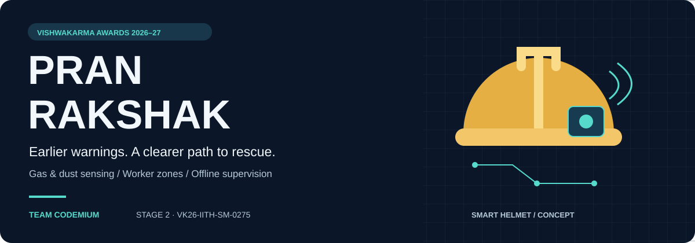
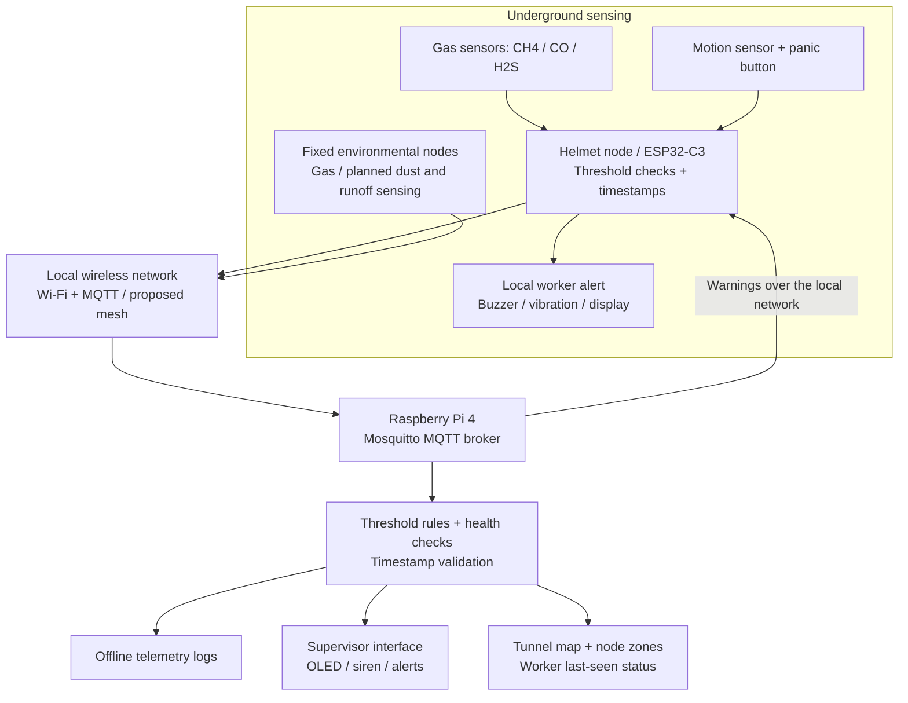
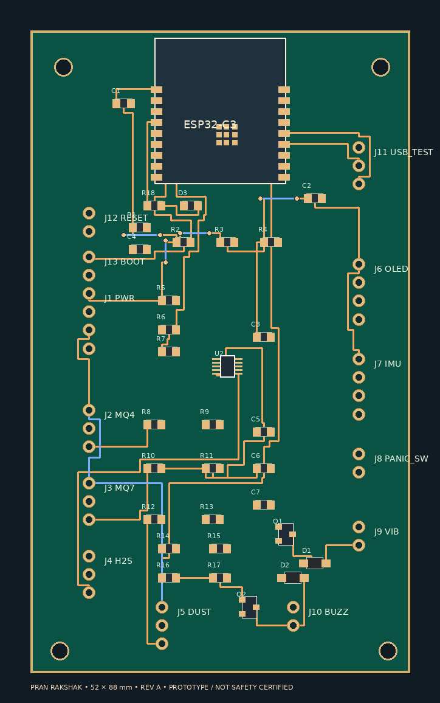
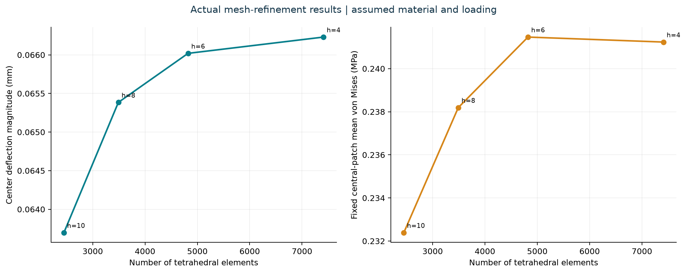

<p align="center"></p>

<h1 align="center">PRAN RAKSHAK</h1>
<p align="center"><strong>Worker health, safety &amp; environmental hazard tracking.</strong><br>
An offline-capable mine-safety system bringing hazard warnings, worker zones, and distress alerts into one proposed workflow.</p>

<p align="center"></p>

<p align="center">
  <a href="#the-problem">The problem</a> ·
  <a href="#system-architecture">Architecture</a> ·
  <a href="#kicad-schematic">KiCad schematic</a> ·
  <a href="#pcb-layout-draft">PCB layout</a> ·
  <a href="#preliminary-enclosure-fea">FEA study</a> ·
  <a href="#cad-and-design-evidence">CAD gallery</a> ·
  <a href="cad/VKA2026.step">STEP model</a> ·
  <a href="docs/stage-2-submission.pdf">Stage 2 submission</a> ·
  <a href="#roadmap">Roadmap</a>
</p>

## PRAN RAKSHAK

PRAN RAKSHAK is a mine safety project designed to detect underground hazards, warn workers locally, and help rescue teams identify a worker's last-known zone. The proposed system combines helmet-mounted sensing, fixed monitoring nodes, and a Raspberry Pi gateway that can operate without a continuous internet connection.

Its scope covers methane, carbon monoxide, and hydrogen sulfide monitoring, with dust exposure and mine-runoff quality monitoring included in the wider environmental design. A panic button and motion-based man-down detection support worker distress alerts.

> **Current stage:** CAD, schematic, preliminary PCB design, and an assumption-based lid FEA study. Native files, numerical outputs, plots, and check reports are published. The schematic and PCB remain different design variants. Material and loading for the FEA are illustrative; firmware, calibration, and physical field validation remain pending.

## The problem

Underground miners can encounter toxic gases and respirable dust in areas with intermittent communication and limited visibility. Manual checks leave gaps between readings. If a worker becomes unresponsive, a team also needs to know where to search.

The Stage 2 submission identifies three connected monitoring gaps:

- Gas and dust exposure can build up between handheld inspections.
- Separate monitoring and communication systems delay distress alerts and worker location updates.
- Mine runoff may reach surrounding waterways before manual water-quality checks identify contamination.

PRAN RAKSHAK is intended for miners, ventilation officers, environmental monitoring teams, and rescue squads working across tunnels and nearby catchment areas.

## The proposed solution

Helmet-mounted nodes monitor conditions close to each worker. Fixed nodes extend environmental coverage through the mine. Both feed a local gateway for logging and supervision, while node-level threshold checks support alarms during a gateway connection loss.

| Capability | Proposed behavior |
| --- | --- |
| Hazard monitoring | Sample CH4, CO, and H2S; extend sensing to dust and runoff quality as those subsystems are defined. |
| Worker warnings | Trigger local buzzer/vibration alerts and display warnings when configured thresholds are crossed. |
| Emergency signaling | Send a manual panic event or an automatic man-down event after sustained inactivity. |
| Underground localization | Associate workers with nearby node zones on a mapped tunnel layout; retain last-seen information. |
| Offline supervision | Run the MQTT broker, rules, monitoring interface, and logs on an on-site Raspberry Pi. |
| Fault visibility | Flag missing nodes, stale packets, sensor faults, and low-power conditions. |

The submission also proposes airflow-aware leak-source estimation and early anomaly detection. These require ventilation measurements, calibration data, and validation beyond the current CAD model.

## System architecture

The diagram summarizes the proposed data flow in the submission. It does not represent software already included in this repository.



1. A node captures sensor readings and attaches a timestamp and node identity.
2. The controller checks local alarm conditions and sends telemetry over the local network.
3. The gateway validates incoming data, applies rules, and records readings offline.
4. Supervisors receive hazard and node-health information; worker positions are associated with mapped zones.

Wi-Fi/MQTT is the baseline communication design. Multi-hop routing, Kinetic Mesh, and alternative radio fallbacks appear in the submission as proposed extensions; their implementation and underground coverage remain to be demonstrated.

## Hardware and software design

The table describes the four-sheet schematic design. The separate [PCB carrier draft](#pcb-layout-draft) uses a different ADC, GPIO map, and external power arrangement.

| Subsystem | Design or proposal | Status |
| --- | --- | --- |
| Controller | ESP32-C3-WROOM-02-N4 with boot/reset circuit, native USB, and battery-state monitoring. | Schematic complete; firmware and bring-up pending. |
| Gas sensing | MQ-4 (methane) and MQ-7B (CO) with signal conditioning and heater control; conditioned H2S module interface. | Calibration, heater power verification, and final H2S module/AFE selection open. |
| Worker interface | LIS3DH accelerometer, manual panic button, 128 × 64 OLED, and vibration-motor driver. | Man-down algorithm, thresholds, and false-alarm testing pending. |
| Environmental scope | Proposed SPS30 dust interface; temperature/humidity component in CAD; runoff subsystem unspecified. | Sensor suitability and packaging unresolved. |
| Power | Protected pack interface, TP4056 charging, charge/run switch, boost converter, and regulated rails. | Bench verification and runtime measurement pending. |
| Local gateway | Raspberry Pi 4, Mosquitto MQTT, microSD logging, OLED or display, and siren/alert output. | Proposed software architecture and wiring require implementation. |
| Enclosure | STEP assembly with removable lid and mounting standoffs. | Packaging, material choice, sensor access, sealing, and mounting unresolved. |

## KiCad schematic

The [Revision A KiCad package](hardware/README.md) contains a four-sheet, editable ESP32-C3 node design. It includes project-local symbols, a reference-level BOM, the exported netlist, and electrical verification records. Proposed parts and unresolved interfaces are identified in its [design notes](hardware/kicad/Design_Notes.md).

[](hardware/kicad/Schematic_Review.pdf)

*Main controller sheet. Open the [four-page schematic PDF](hardware/kicad/Schematic_Review.pdf) for readable details and the power, gas-sensor, and user/environment sheets.*

| Sheet | Contents |
| --- | --- |
| [PRAN_RAKSHAK.kicad_sch](hardware/kicad/PRAN_RAKSHAK.kicad_sch) | ESP32-C3 controller, boot/reset, native USB, battery monitoring, and child-sheet hierarchy. |
| [Power.kicad_sch](hardware/kicad/Power.kicad_sch) | Protected pack interface, TP4056 charging, charge/run switch, boost converter, and regulators. |
| [Gas_Sensors.kicad_sch](hardware/kicad/Gas_Sensors.kicad_sch) | MQ-4/MQ-7B signal conditioning, heater selection, and conditioned H2S module interface. |
| [User_And_Environment.kicad_sch](hardware/kicad/User_And_Environment.kicad_sch) | Proposed SPS30 dust interface, LIS3DH accelerometer, OLED, panic input, and vibration-motor driver. |

Download the [complete KiCad ZIP](hardware/PRAN_RAKSHAK_KiCad.zip), or use the cloned repository. In KiCad 10, open [`hardware/kicad/PRAN_RAKSHAK.kicad_pro`](hardware/kicad/PRAN_RAKSHAK.kicad_pro), then open the schematic. Keep all four sheets, `PRAN.kicad_sym`, and `sym-lib-table` together.

| Design evidence | Result or file |
| --- | --- |
| Native KiCad ERC | **0 electrical errors, 68 footprint-review warnings, no exclusions or ignored checks**, reproduced with KiCad 10.0.7 after importing the package into this repository. |
| Remaining schematic warnings | Unassigned footprints; footprint selection is still required for this schematic. Its ERC result does not validate the separate PCB draft. |
| Verification record | [Original ERC JSON](hardware/kicad/ERC_Report.json) and [verification notes](hardware/kicad/Verification.md), which record 125 connection/structure checks. |
| Bill of materials | [Full BOM](hardware/kicad/BOM.csv) and [short BOM with proposed selections](hardware/kicad/Short_BOM.md); prices have not been quoted. |

The four-sheet Revision A design is a bench schematic. Its calculations estimate approximately **2.4–3.1 hours** of runtime under the stated load assumptions, below the eight-hour target. The proposed MQ-7B's **150-second heater cycle** also prevents a guaranteed fresh CO measurement within ten seconds across all phases. The H2S cell/AFE remains an open design item. See the [electrical design notes](hardware/kicad/Design_Notes.md) before building. The separate layout below has not been matched to this schematic.

## PCB layout draft

The [standalone PCB package](hardware/pcb/README.md) contains an editable **52 × 88 mm, two-layer carrier board** with 49 footprint instances and 27 named electrical nets. It places an ESP32-C3 module, ADS1115 external ADC, sensor headers, and alarm-driver circuitry, with preliminary copper routing and antenna keepouts.

<p align="center">
  <a href="hardware/pcb/PRAN_RAKSHAK_RevA.kicad_pcb"></a>
  <br><sub>Supplied programmatic placement/copper preview. This is a layout draft, not a DRC screenshot or fabricated board.</sub>
</p>

| PCB deliverable | Link or status |
| --- | --- |
| Editable board | [PRAN_RAKSHAK_RevA.kicad_pcb](hardware/pcb/PRAN_RAKSHAK_RevA.kicad_pcb) — open directly in KiCad PCB Editor. |
| Complete source package | [Download the original PCB ZIP](hardware/PRAN_RAKSHAK_KiCad_RevA_Design_Package.zip). All seven supplied files are preserved. |
| Components and connections | [PCB BOM](hardware/pcb/PRAN_RAKSHAK_RevA_BOM.csv) and [pad-to-net mapping](hardware/pcb/PRAN_RAKSHAK_RevA_Net_Mapping.csv). |
| Original design records | [Supplied README](hardware/pcb/PRAN_RAKSHAK_RevA_README.md), [routing summary](hardware/pcb/PRAN_RAKSHAK_routing_status.txt), and [generator source](hardware/pcb/build_pran_pcb.py). |
| Native KiCad review | [DRC JSON](hardware/pcb/review/DRC_Report.json), [review conditions](hardware/pcb/review/README.md), and [KiCad layer export](hardware/pcb/review/PCB_Layers.svg). |
| DRC result | **61 rule violations: 5 errors and 56 warnings, plus 33 unconnected items.** Checked with KiCad 10.0.7 after filling zones in memory; the supplied board file was not changed. |

This carrier is **not fabrication-ready**. It requires externally regulated 3.3 V and 5 V supplies and includes no battery charger or battery-protection circuit. Its ADS1115 interface, analog dust placeholder, GPIO assignments, and connector map differ from the four-sheet schematic. It has no matching native schematic in the supplied package; schematic/PCB parity has not been checked. Five default DRC checks remain ignored in this standalone-board review.

Complete the routing, resolve DRC findings, verify footprints and power interfaces, and reconcile the board with a matching schematic before fabrication. The original routing summary is an algorithmic source record; the new native KiCad report records the integration review. Neither design is certified for explosive mine environments.

## Engineering targets

These targets come from the project specification on page 7 of the [Stage 2 submission](docs/stage-2-submission.pdf). They have not been verified by measurements in this repository. The KiCad design notes identify current runtime and CO-sensor timing conflicts with these targets.

| Parameter | Design target |
| --- | --- |
| Gas sampling | 1 Hz for CH4, CO, and H2S |
| End-to-end gas alert | Less than 10 seconds between threshold crossing and helmet warning |
| Battery endurance | 8 hours on a 3.7 V, 2500 mAh LiPo |
| Average node power | Approximately 1 W, with sensor-heater duty cycling proposed |
| Wearable pod envelope | Approximately 52 × 88 × 28 mm and 120 g target; STEP inspection gives a 100 × 70 × 25 mm enclosure and 100 × 70 × 3 mm lid, so packaging remains to be reconciled |
| Ingress protection | IP67 target; no ingress-test evidence supplied |
| Offline logging | At least 7 days at the local gateway |
| Missing-node detection | Flag a node within 30 seconds of lost contact |
| Man-down detection | Trigger after 30 seconds without motion |
| Worker localization | Nearest-node zone on a mapped tunnel network |

## CAD and design evidence

The three supplied screenshots retain the CAD application's component browser and workspace. They show the enclosure arrangement and assembly structure at the time of capture.

| Assembly overview | Enclosure and component tree |
| --- | --- |
| [](assets/cad/assembly-overview.jpeg) | [](assets/cad/enclosure-components.jpeg) |
| Board placement, gas-sensor module, internal wiring, and exploded lid. | Enclosure and mounting components visible alongside the assembly. |

### Download and inspect the model

- [Download VKA2026.step](https://github.com/SrivarsanK/PranRakshak/raw/refs/heads/main/cad/VKA2026.step)
- [Browse the model in this repository](cad/VKA2026.step)
- [Read the CAD component guide and provenance notes](cad/README.md)

Clone the repository to keep the model and its documentation together:

```bash
git clone https://github.com/SrivarsanK/PranRakshak.git
cd PranRakshak
```

Import `cad/VKA2026.step` into a STEP-compatible CAD application such as Fusion, FreeCAD, or SolidWorks. Units are millimetres. With the lid in its exploded position, inspect the enclosure, component placement, standoffs, and wiring.

The supplied file is a STEP assembly exchange model. The originating application's editable sketches and parametric feature history are separate deliverables and are not included here.

## Preliminary enclosure FEA

An [actual numerical lid-pressure study](simulation/lid-pressure/README.md) has been run using the lid extracted from the STEP assembly. Material and service loading are undecided, so the study uses an **assumed isotropic polymer (E=2000 MPa, ν=0.35), a uniform 10 N downward force, and idealized fixed screw-hole walls**. It is a preliminary setup, with no material-strength or safety pass claimed.

[](simulation/lid-pressure/Report.html)

| Study output | Published result |
| --- | --- |
| Geometry | Actual lid: 100 × 70 × 3 mm, four 3.5 mm holes. |
| Solves | Four meshes: 2,449, 3,490, 4,822, and 7,411 tetrahedra. Final mesh: 14,188 quadratic displacement nodes and 42,564 DOFs. |
| Conditional centre deflection | 0.06623 mm under the assumed material, supports, and 10 N load. |
| Selected convergence check | Centre deflection and a fixed central stress-probe measure each changed by less than 2% for two successive refinements; final changes were 0.319% and 0.096%. |
| Numerical checks | Analytical uniaxial-tension solver/probe check passed; force balance and free-DOF residual checked for each lid solve. |
| Files | [Visual report](simulation/lid-pressure/Report.html), [detailed study](simulation/lid-pressure/README.md), [mesh statistics CSV](simulation/lid-pressure/results/mesh_statistics.csv), [editable assumptions](simulation/lid-pressure/study.json), and [complete study ZIP](simulation/PranRakshak_Preliminary_Lid_FEA.zip). |

Tagged Gmsh meshes, VTU fields, full solution coefficients, mesher logs, and source code are included. Convergence applies to the two selected measures; it is not an absolute error bound or proof that clamp-region maximum stress has converged. This isolated-lid static study establishes no drop resistance, enclosure sealing, helmet compliance, or intrinsic-safety certification.

## Safety and reliability plan

The submission describes the following protections for implementation and testing:

| Failure condition | Planned response |
| --- | --- |
| Sensor drift, failure, or a stuck reading | Calibration checks, plausibility checks, and an explicit sensor-fault alert. |
| Node loses its gateway connection | Continue local threshold alarms; retry communication and flag the missing node at the gateway. |
| Stale or clock-skewed telemetry | Timestamp packets and reject stale data before localization; the FMEA proposes a 10-second cutoff. |
| Low battery or brownout | Monitor supply state, issue a low-power warning, and test watchdog/reset behavior. |
| Gateway failure | Preserve node-level alarms and identify loss of central monitoring. |
| Ventilation changes or poor node placement | Update the tunnel map and airflow assumptions, then repeat localization tests. |

Intrinsic safety, flame protection, enclosure sealing, and impact resistance require further engineering and test evidence. No mining-equipment certification is claimed by the materials in this repository.

## Roadmap

The schedule below follows the submission's October 2026–January 2027 fabrication plan. Schematic and standalone PCB drafts are now published, along with ERC and DRC evidence. Matching the two designs, completing routing, resolving checks, procurement, and calibration remain open.

| Period | Planned work | Evidence to publish |
| --- | --- | --- |
| October 2026 | Reconcile the schematic and PCB variants, complete routing, resolve footprints and open interfaces, procure components, and bench-calibrate sensors. | Native schematic and PCB drafts, BOMs, ERC, and failing DRC report published; final design, quotes, and calibration records pending. |
| November 2026 | Assemble four sensor nodes and the helmet unit; bring up the Pi gateway, broker, display, and alarms. | Assembly photos, firmware, gateway configuration, and timestamped telemetry. |
| December 2026 | Test connectivity, node loss, man-down detection, watchdogs, brownouts, and corridor localization. | Integration logs and measured alert/localization behavior. |
| January 2027 | Run endurance and drift tests, tune the system, and prepare the Stage 3 demonstration. | Battery measurements, soak-test records, and demonstration evidence. |

## Repository contents

```text
PranRakshak/
├── README.md
├── assets/
│   ├── pran-rakshak-banner.png
│   ├── readme/
│   │   └── (SVG visuals)
│   ├── cad/
│   │   ├── assembly-wiring.jpeg
│   │   ├── assembly-overview.jpeg
│   │   └── enclosure-components.jpeg
│   ├── schematic/
│   │   └── esp32-c3-overview.png
│   └── pcb/
│       └── pcb-overview.png
├── cad/
│   ├── README.md
│   └── VKA2026.step
├── hardware/
│   ├── README.md
│   ├── PRAN_RAKSHAK_KiCad.zip
│   ├── PRAN_RAKSHAK_KiCad_RevA_Design_Package.zip
│   ├── kicad/                    # Four-sheet schematic project and verification records
│   └── pcb/                      # Separate carrier board, source files, and native DRC review
├── simulation/
│   ├── PranRakshak_Preliminary_Lid_FEA.zip
│   └── lid-pressure/             # Assumptions, solver, report, meshes, fields, and convergence plots
└── docs/
    ├── banner-design.md
    ├── design-notes.md
    └── stage-2-submission.pdf
```

For the evidence inventory, source-page mapping, and unresolved specification details, see [design notes](docs/design-notes.md).

## Team and submission

| Field | Details |
| --- | --- |
| Project | PRAN RAKSHAK |
| Team | Codemium |
| Team leader | Kaaviya Varshini V |
| Team ID | VK26-IITH-SM-0275 |
| Event | Vishwakarma Awards 2026–27, Stage 2 |
| Theme | Theme 5: Sustainable Mining — Worker Health, Safety & Environmental Hazard Tracking |

## Sources and acknowledgements

The team's [Stage 2 submission PDF](docs/stage-2-submission.pdf) supplies the project scope and specifications; the CAD screenshots and STEP model document the supplied design. Template examples are excluded as evidence of completed work.

The [Revision A electrical design notes](hardware/kicad/Design_Notes.md) document the KiCad schematic's engineering choices, calculations, and component datasheet references. These proposed choices are distinguished from the submission's requirements.

The separate PCB package was supplied through [Explain KiCad EDA Layout](https://chatgpt.com/share/6ade29ec-7dcc-83ee-a8ff-30b51f544990). Its [source README](hardware/pcb/PRAN_RAKSHAK_RevA_README.md) records the carrier-board assumptions; the [repository review](hardware/pcb/review/README.md) adds the native KiCad DRC result.

The [preliminary FEA report](simulation/lid-pressure/README.md) records the mechanical study assumptions, source-geometry hash, solver versions, numerical checks, and method references.

<p align="center"><sub>Team Codemium · Engineering toward safer underground work.</sub></p>