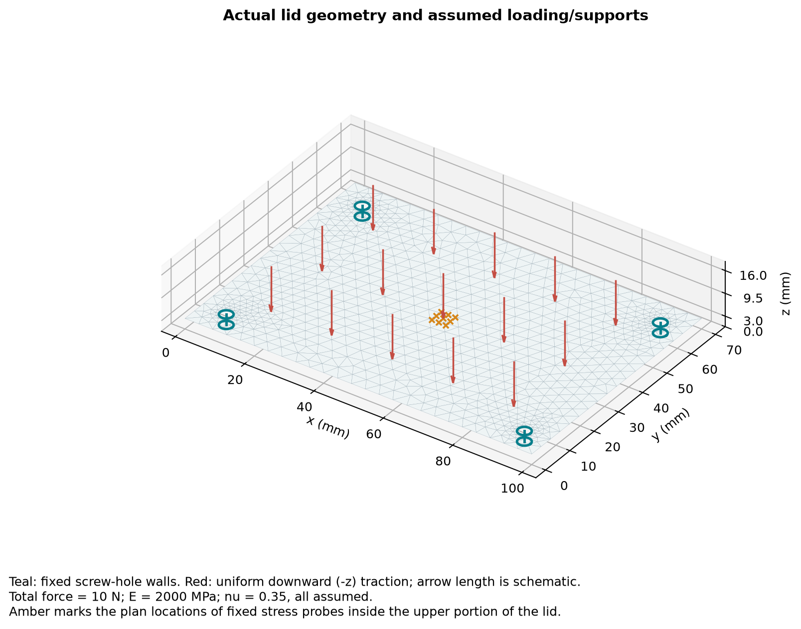
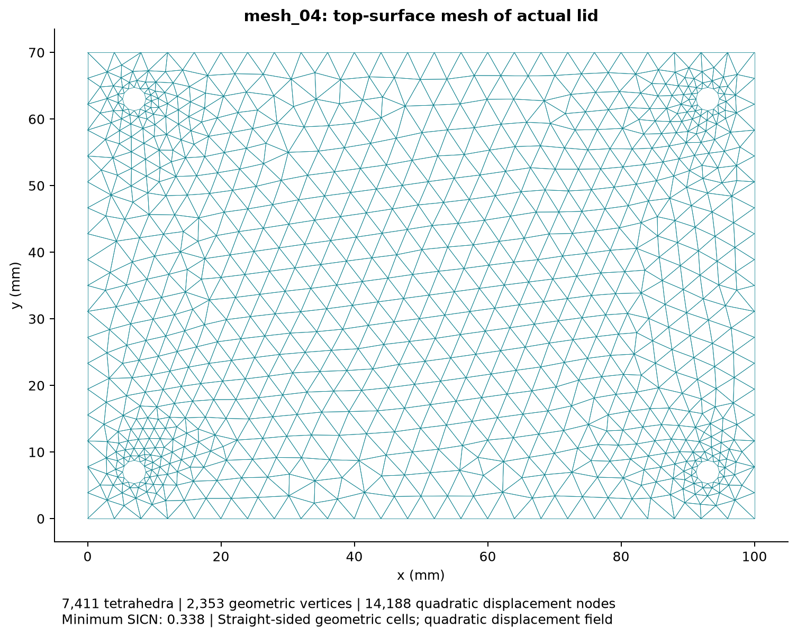
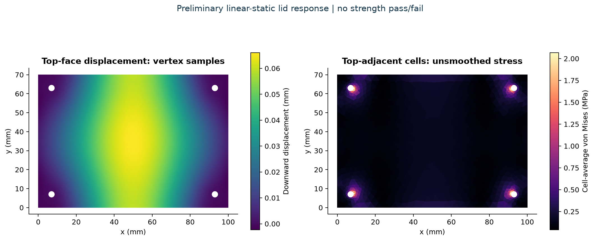

# Preliminary enclosure-lid FEA

The study contains actual finite-element solves of the lid extracted from the supplied STEP assembly. The material and loading were undecided, so the user authorized a preliminary assumed study. These results are conditional on the setup below; no material-strength or product-safety pass is claimed.

[Visual report](Report.html) · [Configuration](study.json) · [Complete mesh statistics](results/mesh_statistics.csv) · [Machine-readable results](results/summary.json)

## Geometry and assumptions

| Item | Study definition |
| --- | --- |
| Geometry | Actual named lid from [VKA2026.step](../../cad/VKA2026.step), 100 × 70 × 3 mm, four 3.5 mm diameter holes. |
| Source pose | Exploded lid translated by -37 mm in z to the analysis position z=0..3 mm; shape unchanged. |
| Material | Assumed homogeneous isotropic linear-elastic polymer, E=2000 MPa and Poisson ratio 0.35. No material grade or print-process properties selected. |
| Load | 10 N uniformly downward over the meshed top face; final pressure 0.00143611 MPa. This is an illustrative loading scenario. |
| Supports | All three displacement components fixed on the four cylindrical screw-hole walls. These idealized rigid supports omit fastener/contact flexibility. |
| Formulation | 3-D small-displacement linear elasticity; quadratic displacement tetrahedra over straight-sided tetrahedral geometry. Units: mm, N, MPa. |
| Excluded | Enclosure base, electronics, helmet, bolts/preload, gasket contact, impact/drop, fatigue, creep, plasticity, thermal and sealing qualification. |

The imported enclosure is 100 × 70 × 25 mm. It differs from the submission's 52 × 88 × 28 mm target; this study uses the actual supplied lid and does not resolve that packaging difference.



## Mesh statistics and convergence

| Target h (mm) | Tetrahedra | Geometric vertices | P2 field nodes | DOFs | Centre abs(uz) (mm) | Probe mean VM (MPa) | Deflection change | Probe stress change |
| --- | --- | --- | --- | --- | --- | --- | --- | --- |
| 10 | 2,449 | 772 | 4,630 | 13,890 | 0.0636966 | 0.232387 | — | — |
| 8 | 3,490 | 1,062 | 6,473 | 19,419 | 0.0653845 | 0.238192 | 2.581% | 2.437% |
| 6 | 4,822 | 1,508 | 9,116 | 27,348 | 0.0660195 | 0.241465 | 0.962% | 1.355% |
| 4 | 7,411 | 2,353 | 14,188 | 42,564 | 0.0662305 | 0.241233 | 0.319% | 0.096% |

The configured preliminary criterion is less than 2% change in both selected response measures for 2 successive refinements, with at least 4 mesh levels. That criterion was **met**. Percentage change is `100 * abs(new - previous) / abs(new)`.

Deflection is evaluated at the fixed physical centre (50, 35, 1.5) mm. The stress measure is the arithmetic mean of von Mises stress at nine fixed physical points with x=48/50/52 mm, y=33/35/37 mm, and z=2.7 mm. It is **not the maximum stress in the lid**. The field is evaluated directly without nodal stress smoothing.

Geometric vertices are the nodes stored in the first-order Gmsh mesh. P2 field nodes include the edge displacement nodes generated by scikit-fem; each has three displacement DOFs. Curved hole walls are approximated by planar facets. The target h is an upper mesh-size control, not the size of every element; curved features receive local refinement. This successive-mesh check does not bound every geometric or solution error.




## Results under the assumed setup

- Centre downward displacement: **0.0662305 mm**.
- Fixed central-patch mean von Mises stress: **0.241233 MPa**.
- Largest sampled quadrature-point von Mises stress: 2.915480 MPa. Peaks near idealized clamps can be mesh-sensitive; this value is not used as a converged strength result.
- Applied z force: -10.000000000 N; support z reaction: 10.000000000 N.
- Final mesh minimum SICN: 0.3380; fifth percentile: 0.6275. Higher positive SICN indicates better conditioning under this metric; it is not a universal acceptance threshold.

No yield/ultimate strength was selected, so no factor of safety or strength pass/fail was calculated. The centre displacement is about 2.21% of the lid thickness in this scenario.



## Numerical verification

Before solving the lid, the same elasticity assembly, traction loading, boundary-DOF treatment, and point-stress evaluation passed an independent unit-cube uniaxial-tension test against its analytical displacement and stress field. Relative displacement error: 2.420e-15; maximum stress-component error: 8.216e-15 MPa. See [verification JSON](results/solver_verification.json).

Each lid solution was checked for global force balance and free-DOF residual. Final relative force-balance error: 3.257e-12; relative free-DOF residual: 1.378e-10. These are numerical checks, not experimental validation of the material, supports or loading.

## Open and reproduce

1. Open `Report.html` for the illustrated report.
2. Open `results/meshes/mesh_04.msh` in Gmsh to inspect the tagged 3-D mesh. `loaded_top` and `screw_walls` identify the load and support surfaces.
3. Open `results/mesh_04.vtu` in a VTK-compatible viewer to inspect vertex-sampled displacement and cell-average stress. This visualization uses the linear geometric mesh; full quadratic displacement coefficients are retained in the corresponding `_solution.npz` file.
4. To rerun from the repository root, use Python 3.12 in an isolated environment:

```bash
python -m venv .venv-fea
# Windows: .venv-fea\Scripts\python.exe
# macOS/Linux: .venv-fea/bin/python
.venv-fea\Scripts\python.exe -m pip install -r simulation/lid-pressure/requirements.txt
.venv-fea\Scripts\python.exe simulation/lid-pressure/run_study.py
```

The script selects the actual lid by its imported name, checks that it has four cylindrical holes, records source SHA-256, generates and solves meshes, checks forces, exports raw outputs, and rebuilds this report. Change `study.json` when the actual material and loading are selected. Absolute constants in this checked-in report describe the published study snapshot; review geometry/probe locations when changing the source geometry.

`run_study.py --verify-only` repeats the analytical solver/probe test. `run_study.py --plots-only` rebuilds figures and reports from the existing solved data. Re-running the full study overwrites its result files; `summary.json` identifies the mesh levels in the current run.

## Evidence and limits

The folder includes native STEP extraction, tagged Gmsh meshes, solver code/configuration, full displacement coefficients, VTU field exports, mesher logs, CSV statistics, JSON results, and PNG/SVG plots. These figures come from actual numerical solves; they are not screenshots of Fusion or evidence of physical fabrication.

The generic material has no assigned strength, anisotropy, print orientation, temperature dependence or manufacturing defects. The rigid hole-wall constraints can overestimate mounting stiffness. Experimental material data, actual service loads, realistic contacts, a suitable failure criterion, and physical validation are needed before a product-design decision. This study establishes no drop resistance, IP rating, helmet compliance or intrinsic-safety certification.

## Software and method references

- [Gmsh manual](https://gmsh.info/doc/texinfo/gmsh.html): STEP/OpenCASCADE import, tagged meshing and SICN mesh-quality metric.
- [scikit-fem 3-D elasticity example](https://github.com/kinnala/scikit-fem/blob/12.0.2/docs/examples/ex11.py): linear-elasticity formulation.
- [scikit-fem how-to](https://scikit-fem.readthedocs.io/en/stable/howto.html): boundary DOFs, postprocessing and field export.
- [Autodesk mesh convergence guidance](https://help.autodesk.com/cloudhelp/ENU/Fusion-Simulate/files/SIM-MESH-CONVERGENCE.htm): compare consistent physical locations during refinement.

Software versions are recorded in `results/summary.json`; direct dependencies are pinned in `requirements.txt`. Source STEP SHA-256: `8857d052af91eca43b5cf8fd16ea1c35b9f05d296f065b5a0be92e9c094a27be`.
